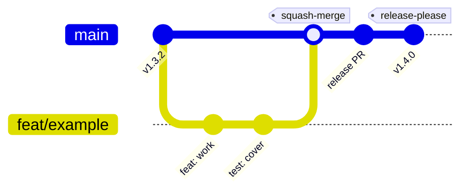
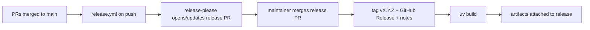

# Contributing to Nest

This document describes how changes flow from a working branch to a published
release. Nest uses a **trunk-based workflow**: a protected `main`, fast automated
validation on every change, and a fully repeatable release pipeline.

## Branching strategy

`main` is the single long-lived branch. It is always releasable and is
protected - nothing lands on it except through a reviewed pull request that
passes CI.

All work happens on **short-lived branches** cut from `main` and named after the
Conventional Commit type of the change:

| Prefix     | Use for                                   | Release impact |
| ---------- | ----------------------------------------- | -------------- |
| `feat/`    | New user-facing capability                | minor          |
| `fix/`     | Bug fix                                   | patch          |
| `refactor/`| Internal restructuring, no behavior change| none           |
| `docs/`    | Documentation only                        | none           |
| `test/`    | Tests only                                | none           |
| `chore/`   | Tooling, deps, housekeeping               | none           |
| `ci/`      | CI/CD and pipeline changes                | none           |
| `build/`   | Build system or packaging changes         | none           |
| `perf/`    | Performance improvement                   | patch          |

Example: `feat/sync-parallelism`, `fix/symlink-discovery`.

Keep branches small and focused. Rebase on `main` rather than merging `main`
into your branch to keep history linear.



## Commit and PR conventions

All commits and PR titles follow
[Conventional Commits](https://www.conventionalcommits.org/). This is not
cosmetic: **release-please** derives the semantic version bump and the changelog
directly from commit subjects on `main`.

```
<type>(<optional scope>): <subject>

feat(sync): add cross-file parallelism
fix(discovery): keep symlinked files under the sources dir
feat!: drop Python 3.9 support        # breaking change → major
```

- `feat:` → **minor** bump
- `fix:` → **patch** bump
- `feat!:` / `fix!:` / `BREAKING CHANGE:` → **major** bump

PRs are **squash-merged**, so the PR title becomes the commit subject on `main`.
The `PR Validation` workflow enforces the Conventional Commit format (and checks
the branch-name convention).

## Local validation

The [`Makefile`](Makefile) is the single source of truth for every check. Run
the same gate CI runs before opening a PR:

```bash
make ci          # lint + format-check + typecheck + check-deps + deptry + all tests (incl. e2e)
```

Individual targets:

```bash
make lint          # ruff check
make format-check  # ruff format --check
make format        # auto-format
make typecheck     # pyright (strict)
make check-deps    # direct dependency ranges agree with uv.lock
make deptry        # every imported third-party package is declared
make test          # unit + integration tests (fast)
make test-e2e      # end-to-end tests (require Docling ML models, slow)
```

## Continuous integration

Two workflows guard every pull request (see [.github/workflows/](.github/workflows)):

- **CI** (`ci.yml`) - runs on every PR to `main` and on pushes to `main`:
  - `quality`: lint, format check, strict `pyright` type checking, the
    dependency range check (`make check-deps`), and deptry.
  - `test`: unit + integration tests (single run - `uv` installs a compatible
    Python from the project's `requires-python`).
  - `e2e`: full end-to-end suite against real Docling. The ~2.5 GB of ML models
    are cached between runs; LLM-gated tests use the shared test proxy from
    `tests/e2e/conftest.py`.
  - `install-smoke`: installs Nest from the checkout with `uv tool install` -
    a fresh resolution that ignores `uv.lock`, exactly what a user gets - on
    ubuntu and windows, then exercises the installed executable from an empty
    directory with no `NEST_*` configuration. Any Python traceback fails the
    job (see the [dependency policy](#dependency-policy)).
  - `ci-success`: single aggregate check to require in branch protection.

  GitHub-hosted runners have no GPUs, so CI always runs torch on CPU regardless
  of which wheel is installed. The CUDA code path is never exercised in CI.
  Test the GPU path locally on a machine with an NVIDIA GPU before relying on
  GPU-specific behavior. See ADR-0001 for the CPU-only torch optimization in the
  quality job.

- **PR Validation** (`pr-validation.yml`) - validates the Conventional Commit
  format of the PR title (required), plus advisory checks that newly added
  dependencies have no known advisories and that branch names follow the
  convention.

### Branch protection for `main`

Configured to enforce the trunk-based flow:

- Require a pull request before merging.
- Require the **`CI success`** and **`Validate PR title`** status checks to pass.
- Require branches to be up to date before merging.
- Require linear history (squash-merge only).

## Dependency policy

Users install Nest with `uv tool install` (see the README, or `nest update`),
which **ignores `uv.lock`** and resolves the newest versions the ranges in
`pyproject.toml` permit. The principle is: ship what CI tests, and test what
users install.

- Every direct runtime dependency in `pyproject.toml` uses a three-component
  compatible-release range (`~=X.Y.Z`, e.g. `typer~=0.26.8`). Patch releases -
  including security fixes - flow to users without a Nest release; minor and
  major upstream releases reach users only through a reviewed pull request
  that raises the range. Transitive dependencies (for example `click` via
  docling) are not constrained by Nest.
- `make check-deps` (in the `quality` job) fails if any direct dependency uses
  a different specifier or if `uv.lock` resolves one outside its range, so the
  declared ranges and the lock cannot drift.
- The `install-smoke` job (and the same step in the release workflow, which
  gates the artifact upload) installs Nest from the checkout with
  `uv tool install` into an isolated tool directory and exercises the
  executable from an empty directory with no `NEST_*` configuration. Any
  Python traceback fails the job.
- `make deptry` (in the `quality` job) fails on undeclared or transitive
  imports in `src/nest`, so every imported third-party package is declared.
- CI runs with `UV_LOCKED=1`, asserting `uv.lock` matches `pyproject.toml`.
  Nest's own version is dynamic - `src/nest/__init__.py` is the single source
  of truth - so `uv.lock` carries no version for Nest and a release bump
  cannot leave the lock stale.

### Responding to a red `install-smoke` or Dependabot PR

- A **red Dependabot PR** that raises a dependency range means the new version
  fails CI. Reproduce locally by installing into a scratch tool directory
  (`UV_TOOL_DIR=/tmp/nest-check UV_TOOL_BIN_DIR=/tmp/nest-check-bin
  uv tool install .`), then either fix Nest for the new version or cap the
  range. Do not merge a red upgrade PR to "unblock" users: the point of the
  range is that untested versions never reach them.
- A **red `install-smoke`** on an otherwise unrelated PR means a fresh
  resolution broke - a new patch release of a direct dependency or any
  release of a transitive one. The failure output names the command and
  includes the traceback. Fix forward, usually by capping the offending
  dependency (an exclusion or an upper bound) in a follow-up PR.

## Release pipeline

Releases are **fully automated by [release-please](https://github.com/googleapis/release-please)** -
there is no local release script. A release is simply: the change is on `main`,
tagged with a proper semver tag, and published as a GitHub Release with generated
notes.

### The day-to-day flow

Merging a feature PR is an ordinary merge - there is no release step and nothing
extra to approve.

1. **Merge the feature/fix PR** to `main`. No release happens yet.
2. Release-please maintains a standing **release PR** (branch
   `release-please--main`, titled e.g. *"chore(main): release nest 1.4.0"*) that
   stays up to date. It accumulates every merged Conventional Commit, computes
   the next version, and previews the `CHANGELOG.md` entries. It regenerates
   itself on each merge - it is never edited by hand.
3. **To cut a release**, merge that release PR. This is the only deliberate
   release action.
4. On that merge, release-please creates the `vX.Y.Z` tag and a GitHub Release
   with the accumulated notes, and the workflow attaches the built `dist/*`
   artifacts.

The version bump is derived from commit types (`feat` → minor, `fix` → patch,
`feat!`/`BREAKING CHANGE:` → major).



### Installing a released version

```bash
uv tool install git+https://github.com/jbb10/nest            # latest default branch
uv tool install git+https://github.com/jbb10/nest@vX.Y.Z     # a specific release
```
